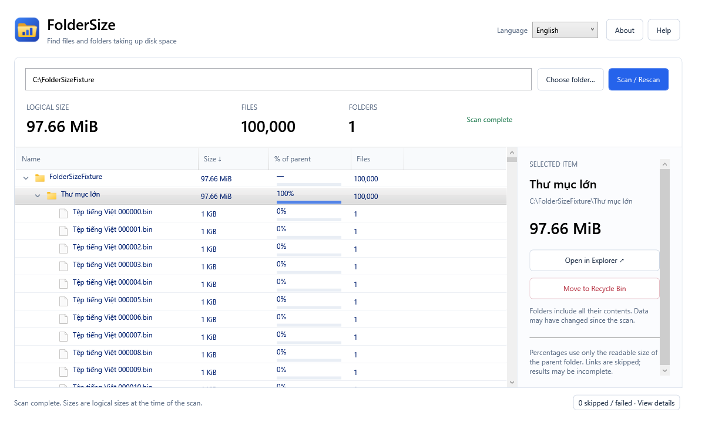

**Language / Ngôn ngữ:** [English](README.en.md) · [Tiếng Việt](README.md)

<p align="center">
  
</p>

# FolderSize

**Find files and folders taking up disk space on Windows.**

FolderSize scans a folder or drive, displays its logical size as a tree, and lets you open items in Explorer or move individual items to the Recycle Bin.

**Version 1.2.0 · Windows 10/11 x64 · Portable · English / Vietnamese**



[Release notes (Vietnamese)](RELEASE_NOTES.md) · [Verification record (Vietnamese)](docs/verification.md) · [GitHub](https://github.com/anhlt3010/foldersize)

## Features

- Scan a folder or an entire drive and calculate logical size, file count, and folder count.
- Browse files and folders in a tree, sorted by descending size within each parent after the scan completes.
- Expand and collapse branches, view each item's percentage of its parent, and inspect the selected item in the details panel.
- Use Windows icons for drives, open/closed folders, and file types.
- Switch between **English / Tiếng Việt** immediately and remember the choice for the next launch.
- Scan in the background, cancel while keeping partial results, and review unreadable or skipped items.
- Open an item in Explorer or move one item to the Recycle Bin after confirmation, with an automatic rescan after successful or partial completion.
- Use a virtualized list to limit the number of controls when browsing large trees.

## Run the portable app

1. Extract the **entire** `FolderSize-1.2.0-win-x64.zip` archive into a folder.
2. Open `FolderSize.App.exe` from that folder.
3. Keep the `LICENSE` file with the executable when redistributing the software.

The portable release includes its .NET runtime inside the EXE. You do not need to install .NET separately. The app does not automatically request administrator privileges.

The release package contains one EXE and `LICENSE`, with no PDB files or loose DLLs. Build artifacts are not stored in Git. **Code → Download ZIP** downloads source code; build it using the instructions below before running it.

### Using FolderSize

1. Click **Choose folder…** or enter an absolute folder or drive path.
2. Click **Scan / Rescan**, or press **Enter** in the path field.
3. Click the arrow beside a folder to expand or collapse it. **Left/Right** also collapse or expand the selected branch.
4. Select a row to view its path, size, and available actions in the panel on the right.
5. To remove an item, click **Move to Recycle Bin**, check the path in the confirmation dialog, then continue or cancel.

**Cancel** keeps the data collected so far, marks the results as incomplete, and disables recycling. Run **Scan / Rescan** to obtain fresh results. Use **View details** at the bottom of the window to inspect failed or skipped items.

### Change the language

Select **English** or **Tiếng Việt** in the upper-right corner. Labels, status messages, column headers, tooltips, Help, About, and number formats update immediately. File names, paths, scan results, selection, and expanded branches stay unchanged. You can switch while a scan is running.

The preference is stored in `%LOCALAPPDATA%\FolderSize\settings.json`. Missing or malformed settings fall back to Vietnamese. If saving fails, the language still changes for the current session and the app displays a warning. Native Windows dialog buttons and operating-system error details follow the Windows language.

## Understand the results

| Item | Meaning |
| --- | --- |
| Logical size | The sum of file lengths reported by metadata, using base 1024: B, KiB, MiB, GiB, TiB. It can differ from physical disk usage and the Used value shown by Windows. |
| Percentage of parent | Calculated from the readable size of the parent. A zero-sized parent shows “—”. |
| Incomplete | An item could not be read, disappeared, or was skipped. The incomplete state propagates to its parent folders. |
| Hard links | Counted per path, so the same underlying data may be counted more than once. |
| Links and cloud files | Junctions, symbolic links, and reparse points are skipped, including cloud files marked as reparse points. File contents are not opened to calculate sizes. |

Results are a snapshot of the scan. Files and folders can change afterward; rescan when you need current figures.

## Move items to the Recycle Bin

- Recycling applies to one selected item after a completed scan and always requires confirmation.
- The scan root and drive roots cannot be recycled. To manage a normal folder itself, scan its parent folder.
- Recycling is supported only on fixed local drives. Network and removable drives are rejected.
- There is no permanent-delete mode and no fallback to permanent deletion when recycling fails.
- After a successful or partial operation, the app rescans automatically. Uncertain results are marked as requiring a rescan, and recycling is disabled.
- **Moving items to the Recycle Bin does not free disk space.** Restore or manage the Recycle Bin through Windows.

The app revalidates paths before an operation, but cannot eliminate every race with other applications changing the filesystem at the same time. See the [verification record (Vietnamese)](docs/verification.md) for test scope and limitations.

## Data and scope

FolderSize processes data locally and does not send file contents or paths over the network. It stores only the language preference in user settings, with no scan history. This version does not automatically clean data, select multiple items, find duplicate files, or update itself.

## Build from source

Use a Windows machine with the **.NET 10.0.403 SDK**, as specified in [global.json](global.json). You can install the SDK locally in `.tools/dotnet`; the build script prefers that installation over the system SDK. Temporary files and caches are stored in `.work`.

Run PowerShell from the repository root:

```powershell
# Run the test suite in Release configuration
./scripts/Build.ps1

# Run tests, publish the portable app, and create a ZIP
./scripts/Build.ps1 -Publish
```

The script creates `artifacts/FolderSize-1.2.0-win-x64`, containing the EXE and `LICENSE`, and `artifacts/FolderSize-1.2.0-win-x64.zip`. The runtime and language catalog are embedded in the EXE. No PDB files or loose DLLs are included. Publishing uses a fresh staging directory to avoid leftover files from earlier builds.

Close any app running from the output directory before republishing so Windows does not lock the EXE. To keep that instance running, choose another output directory:

```powershell
./scripts/Build.ps1 -Publish -OutputDirectory artifacts/FolderSize-custom
```

Distribute the entire published package. WPF trimming is not enabled.

### Additional checks

```powershell
# Check layout, icons, live language switching, and virtualization with 100,000 synthetic files
./.tools/dotnet/dotnet.exe run --project tests/FolderSize.UiSmoke -c Release

# Create owned fixtures and actually move those fixtures to the Recycle Bin
./.tools/dotnet/dotnet.exe run --project tests/FolderSize.ShellSmoke `
  -c Release -- --recycle-owned-fixtures
```

The Shell smoke runner operates only on fixtures it creates and does not empty the Recycle Bin. See the [verification record (Vietnamese)](docs/verification.md) for results and checks that have not been performed.

## Credits and license

**Developed by LTA. © 2026 LTA.** Released under the [MIT License](LICENSE).

Click **About** in the app to see its version and credits. LTA's information is also included in the executable's metadata.

The app icon is an original vector design with sizes from 16 to 256 px. Regenerate it from the [vector source](src/FolderSize.App/Assets/FolderSize.vector.xml) with:

```powershell
./scripts/Generate-AppIcon.ps1
```

Folder, drive, and file-type icons in the tree are provided by Windows Shell and belong to Microsoft or their respective owners. The app does not redistribute the system icon set. File-type icons are requested by extension without reading the target file or downloading cloud file contents.
