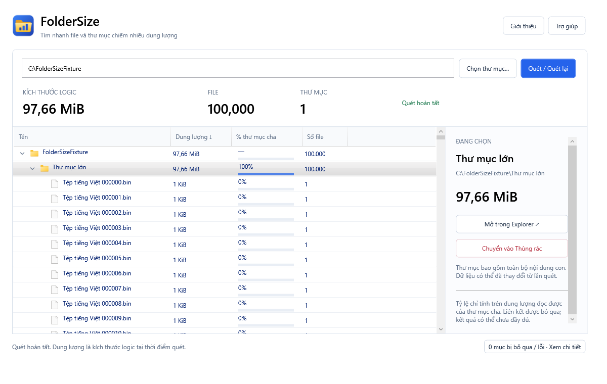

<p align="center">
  
</p>

# FolderSize

**Tìm nhanh file và thư mục chiếm nhiều dung lượng trên Windows.**

FolderSize quét thư mục hoặc ổ đĩa, hiển thị dung lượng theo cây và giúp bạn mở vị trí trong Explorer hoặc chuyển từng mục vào Thùng rác.

**Phiên bản 1.1.1 · Windows 10/11 x64 · Portable · Giao diện tiếng Việt**



[Ghi chú phát hành](RELEASE_NOTES.md) · [Kết quả kiểm tra](docs/verification.md) · [GitHub](https://github.com/anhlt3010/foldersize)

## Tính năng

- Quét thư mục hoặc toàn bộ ổ đĩa; tính kích thước logic, số file và số thư mục.
- Cây chứa cả file và thư mục, sắp xếp dung lượng giảm dần giữa các mục cùng cha sau khi quét xong.
- Mũi tên mở/thu gọn, thanh tỷ lệ so với thư mục cha và bảng chi tiết của mục đang chọn.
- Icon Windows cho ổ đĩa, thư mục đóng/mở và loại file.
- Quét nền, có nút Hủy; giữ kết quả tạm và ghi chi tiết các mục không đọc được.
- Mở vị trí trong Explorer; recycle từng mục sau khi xác nhận và tự quét lại sau kết quả thành công hoặc một phần.
- Danh sách ảo hóa để hạn chế số control khi duyệt cây lớn.

## Chạy bản portable

1. Giải nén **toàn bộ** gói `FolderSize-1.1.1-win-x64.zip` vào một thư mục.
2. Mở `FolderSize.App.exe` trong thư mục vừa giải nén.
3. Giữ nguyên các DLL và tệp runtime đi kèm exe.

Bản portable chứa sẵn runtime .NET, không cần cài .NET riêng. Ứng dụng không tự yêu cầu quyền quản trị.

Gói ZIP là kết quả build, không được lưu trong Git. Nếu bạn tải mã nguồn bằng **Code → Download ZIP**, hãy build theo hướng dẫn bên dưới trước khi chạy.

### Sử dụng

1. Bấm **Chọn thư mục…** hoặc nhập đường dẫn tuyệt đối của thư mục/ổ đĩa.
2. Bấm **Quét / Quét lại**, hoặc nhấn **Enter** trong ô đường dẫn.
3. Bấm mũi tên cạnh thư mục để mở/thu nhánh. Phím **Trái/Phải** cũng đóng/mở nhánh của dòng đang chọn.
4. Chọn một dòng để xem đường dẫn, dung lượng và các thao tác trong bảng bên phải.
5. Khi cần dọn một mục, bấm **Chuyển vào Thùng rác**, kiểm tra đường dẫn trong hộp xác nhận rồi quyết định tiếp tục hoặc hủy.

Nút **Hủy** giữ dữ liệu đã thu thập nhưng đánh dấu kết quả chưa hoàn tất và khóa thao tác xóa. Bấm **Quét lại** để lấy kết quả mới. Các mục bị lỗi hoặc bỏ qua có thể xem qua **Xem chi tiết** ở cuối cửa sổ.

## Hiểu dung lượng hiển thị

| Nội dung | Ý nghĩa |
| --- | --- |
| Kích thước logic | Tổng số byte theo metadata của file, dùng hệ 1024: B, KiB, MiB, GiB, TiB. Có thể khác dung lượng thực chiếm trên ổ và số Used của Windows. |
| Tỷ lệ thư mục cha | Tính trên dung lượng đã đọc được của cha. Cha bằng 0 hiển thị “—”. |
| Chưa đầy đủ | Có lỗi truy cập, mục biến mất hoặc nhánh bị bỏ qua; trạng thái này lan lên thư mục cha. |
| Hard link | Tính theo mỗi đường dẫn, nên có thể tính lặp dung lượng. |
| Liên kết và file đám mây | Bỏ qua junction, symbolic link và reparse point, bao gồm file đám mây mang thuộc tính reparse. Không mở nội dung file để tính kích thước. |

Kết quả là ảnh chụp tại thời điểm quét. File và thư mục có thể thay đổi sau đó; hãy quét lại khi cần số liệu mới.

## Chuyển vào Thùng rác

- Chỉ thao tác trên một mục được chọn sau khi quét hoàn tất, luôn có hộp xác nhận.
- Không cho xóa gốc vùng quét hoặc gốc ổ đĩa. Muốn quản lý một thư mục thông thường, hãy quét thư mục cha của nó.
- Chỉ hỗ trợ recycle trên ổ cục bộ cố định; từ chối ổ mạng và ổ rời.
- Không có chế độ xóa vĩnh viễn và không tự chuyển sang xóa vĩnh viễn khi recycle thất bại.
- Sau kết quả thành công hoặc một phần, ứng dụng tự quét lại. Kết quả chưa chắc chắn được đánh dấu cần quét lại và khóa thao tác xóa.
- **Chuyển vào Thùng rác chưa giải phóng dung lượng ổ đĩa.** Bạn tự khôi phục hoặc quản lý Thùng rác trong Windows.

Ứng dụng kiểm tra lại đường dẫn trước thao tác, nhưng không thể loại bỏ hoàn toàn tình huống ứng dụng khác đồng thời thay đổi filesystem. Chi tiết và phạm vi kiểm thử được ghi trong [tài liệu kiểm chứng](docs/verification.md).

## Dữ liệu và phạm vi

FolderSize xử lý dữ liệu cục bộ, không gửi nội dung hoặc đường dẫn file ra mạng. Bản hiện tại không lưu lịch sử quét, tự dọn dữ liệu, chọn nhiều mục, tìm file trùng hoặc tự cập nhật.

## Build từ mã nguồn

Yêu cầu máy Windows và SDK **.NET 10.0.403** theo [global.json](global.json). Có thể cài SDK cục bộ trong `.tools/dotnet`; script ưu tiên SDK này trước SDK trên máy. Thư mục tạm và cache được đặt trong `.work`.

Chạy PowerShell tại thư mục gốc repository:

```powershell
# Chạy bộ test ở cấu hình Release
./scripts/Build.ps1

# Chạy test, publish bản portable và tạo ZIP
./scripts/Build.ps1 -Publish
```

Script tạo thư mục `artifacts/FolderSize-win-x64` chứa exe cùng runtime, và gói `artifacts/FolderSize-win-x64.zip`.

Đóng ứng dụng đang chạy trong thư mục đầu ra trước khi publish lại để Windows không khóa DLL. Nếu muốn giữ phiên đang chạy, có thể xuất sang thư mục khác, ví dụ với SDK cục bộ:

```powershell
./.tools/dotnet/dotnet.exe publish src/FolderSize.App `
  -c Release -r win-x64 --self-contained true `
  -p:PublishSingleFile=false -o artifacts/FolderSize-1.1.1-win-x64

Compress-Archive artifacts/FolderSize-1.1.1-win-x64/* `
  artifacts/FolderSize-1.1.1-win-x64.zip -Force
```

Giữ toàn bộ thư mục publish khi phân phối. Bản WPF không dùng trimming.

### Kiểm thử bổ sung

```powershell
# Kiểm tra bố cục, icon và ảo hóa bằng cây giả 100.000 file
./.tools/dotnet/dotnet.exe run --project tests/FolderSize.UiSmoke -c Release

# Tạo fixture riêng và thực sự chuyển fixture vào Thùng rác
./.tools/dotnet/dotnet.exe run --project tests/FolderSize.ShellSmoke `
  -c Release -- --recycle-owned-fixtures
```

Shell smoke chỉ thao tác với fixture do runner tạo và không dọn Thùng rác. Xem [bằng chứng và những phần chưa xác minh](docs/verification.md).

## Credit và bản quyền

**Phát triển bởi LTA. © 2026 LTA. Bảo lưu mọi quyền.**

Trong ứng dụng, bấm **Giới thiệu** để xem phiên bản và credit. Thông tin LTA cũng được ghi trong metadata của exe.

Icon app được vẽ riêng, có các kích thước 16–256 px. Có thể tái tạo từ [vector nguồn](src/FolderSize.App/Assets/FolderSize.vector.xml) bằng:

```powershell
./scripts/Generate-AppIcon.ps1
```

Icon thư mục, ổ đĩa và loại file trong cây do Windows Shell cung cấp, thuộc Microsoft hoặc chủ sở hữu tương ứng. Ứng dụng không đóng gói lại bộ icon hệ thống; icon loại file được lấy theo phần mở rộng, không đọc file đích hoặc tải nội dung đám mây.
